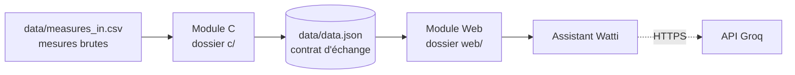

# EcoCampus : suivi énergétique du campus

Système de suivi de la consommation d'**électricité**, d'**eau** et de **chauffage** des bâtiments d'un campus.
Il repère les surconsommations (valeur supérieure au seuil) et les présente dans un tableau de bord web, avec un assistant conversationnel nommé **Watti**.

Projet de l'atelier mini-projet **DSI22** (année universitaire 2026 / 2027), réalisé par l'équipe **ByteSquad**. Enseignante : Mme Imene Jemmali.

## Architecture

Deux modules indépendants qui ne communiquent que par un fichier d'échange, `data.json`.



- **Module C** (le moteur) : charge, valide, trie, calcule les statistiques, détecte les alertes et écrit `data.json`.
- **Module Web** (la vitrine) : lit `data.json` et affiche le tableau de bord (filtres, graphique, alertes) et Watti.

## Structure du dépôt

```
ecocampus/
├── README.md                 ce fichier (documentation générale)
├── .gitignore
├── .github/
│   ├── pull_request_template.md
│   └── workflows/ci.yml      compile le module C et lance ses tests
├── c/                        MODULE C
│   ├── README.md             documentation détaillée du module C
│   ├── gestion.h  gestion.c  types, chargement CSV, ajout, suppression
│   ├── analyse.c             tri (qsort) et statistiques
│   ├── export.c              écriture de data.json
│   ├── main.c                menu du programme
│   └── Makefile  tests.sh    compilation et 32 tests automatiques
├── data/
│   ├── measures_in.csv       jeu de données fourni
│   ├── measures_test.csv     jeu de test (20 mesures, 6 anomalies)
│   ├── measures_erreurs.csv  lignes volontairement invalides
│   └── data.json             fichier GÉNÉRÉ par le module C (non versionné)
└── web/                      MODULE WEB
    ├── index.html
    ├── assets/               logo-ecocampus.svg, watti.svg
    ├── css/style.css
    └── js/
        ├── donnees.js        chargement et validation de data.json
        ├── filtres.js        recherche, filtrage, tri
        ├── graphique.js      histogramme Chart.js
        ├── app.js            point d'entrée, affichage, événements
        ├── groqConfig.js     configuration de l'API Groq
        ├── questionLocal.js  questions locales et réponses de Watti
        └── assistant.js      fenêtre de chat Watti
```

## Démarrage rapide

### Prérequis

- Un compilateur C (GCC) et `make`
- Un navigateur récent (Chrome, Firefox ou Edge)
- Python 3 (ou l'extension VS Code « Live Server ») pour servir la page en local
- Une connexion Internet : Bootstrap, Chart.js et la police Manrope sont chargés depuis des CDN

### 1. Générer `data.json` avec le module C

`data/data.json` est généré et n'est pas dans le dépôt : il faut le produire avant d'ouvrir la page web.

```bash
cd c
make
./ecocompus ../data/measures_test.csv
```

Dans le menu : tapez `1` (charger le CSV), puis `8` (exporter `data.json`), puis `0` pour quitter.
Sous Windows, l'exécutable s'appelle `ecocompus.exe`.

### 2. Ouvrir le module Web

Les navigateurs bloquent `fetch()` sur un fichier ouvert directement. Servez le projet depuis sa racine :

```bash
python -m http.server 8000
```

Puis ouvrez <http://localhost:8000/web/index.html>.
Si `fetch()` est bloqué, le bouton **Charger un fichier** permet de choisir `data.json` à la main.

## Module C

Programme en C99 (environ 430 lignes), compilé sans avertissement.

| Fichier | Rôle | Responsable |
|---|---|---|
| `gestion.h` | types `Mesure`, `Tableau`, `Stat` et prototypes | équipe |
| `gestion.c` | charger le CSV, ajouter (avec calcul de l'alerte), supprimer, afficher et rechercher | Saif |
| `analyse.c` | tri (`qsort`), statistiques par bâtiment et ressource | Ahmed |
| `export.c` | écriture de `data.json` | Ayoub |
| `main.c` | menu, appelle les fonctions des autres fichiers | équipe |
| `Makefile`, `tests.sh` | compilation et tests | Ayoub |

Menu : 1 charger le CSV · 2 afficher / rechercher · 3 ajouter · 4 supprimer · 5 trier · 6 statistiques · 7 alertes · 8 exporter `data.json` · 0 quitter.

Commandes `make` (depuis `c/`) : `make` (compiler), `make run`, `make test` (32 tests automatiques), `make clean`.
Voir [`c/README.md`](c/README.md) pour le détail.

## Module Web

Page unique en HTML5, CSS3 et JavaScript, avec Bootstrap 5.3.3 et Chart.js 4.4.1.

Fonctionnalités :

- chargement de `data.json` au démarrage, bouton **Actualiser**, bouton **Charger un fichier** ;
- contrôle du fichier (champs obligatoires, seuil non nul, ressource connue) avec message d'erreur ;
- recherche et filtrage par bâtiment, ressource, période, « alertes seulement » ;
- tri du tableau des mesures ;
- histogramme du niveau de consommation en pourcentage du seuil, ligne de seuil à 100 % ;
- alertes : lignes en rouge, badge, jauge, bandeau d'état, pire dépassement ;
- statistiques calculées par le module C ;
- thème clair et sombre, adaptation aux petits écrans, impression optimisée.

| Fichier | Rôle | Responsable |
|---|---|---|
| `index.html`, `donnees.js`, `app.js` | page, chargement, affichage | Saif |
| `filtres.js`, `graphique.js`, `style.css` | filtres, graphique, mise en forme | Ahmed |
| `assistant.js`, `groqConfig.js`, `questionLocal.js` | assistant Watti | Ayoub |

## Assistant Watti

Watti répond en français aux questions sur les bâtiments, les ressources, les mesures et les alertes, à partir des données de `data.json`.

- **Réponses locales** : `questionLocal.js` reconnaît 19 intentions et calcule la réponse sans réseau.
- **API Groq** : pour corriger une question mal formulée ou générer une réponse absente du catalogue (modèle `openai/gpt-oss-120b`, secours `openai/gpt-oss-20b`).

Configuration : renseigner la clé dans `web/js/groqConfig.js` (champ `API_KEY`).

> **Attention :** ce fichier est exécuté par le navigateur, donc la clé est visible par quiconque ouvre la page. Ne publiez pas une clé personnelle sur GitHub et révoquez toute clé déjà publiée. Pour une mise en production, la clé doit être gardée côté serveur.

## Format d'échange `data.json`

| Section | Champs |
|---|---|
| `meta` | `version_format`, `genere_le`, `source`, `nb_mesures`, `nb_alertes` |
| `mesures` | `id`, `batiment`, `ressource`, `unite`, `valeur`, `seuil`, `date`, `alerte`, `depassement_pct` |
| `statistiques` | par bâtiment et ressource : `nb_mesures`, `nb_alertes`, `total`, `moyenne`, `max`, `min` |

Ressources suivies : `electricite`, `eau`, `chauffage`. Une mesure est en alerte lorsque sa valeur dépasse son seuil.

## Travail en équipe

| Membre | Rôle | Fichiers |
|---|---|---|
| Gharsalli Saif | module C : chargement ; module Web : page et données | `gestion.c`, `gestion.h`, `app.js`, `donnees.js`, `index.html` |
| Ahmed Lahbib | module C : analyse ; module Web : interface | `analyse.c`, `filtres.js`, `graphique.js`, `style.css` |
| Sfaxi Ayoub | export, tests, Watti, intégration, documentation | `export.c`, `Makefile`, `tests.sh`, `assistant.js`, `groqConfig.js`, `questionLocal.js` |

Règles Git :

1. `main` contient toujours une version qui compile et fonctionne ; personne n'y écrit directement.
2. Chaque tâche se fait dans une branche personnelle (`feature/...`, `docs/...`).
3. Une branche entre dans `main` par une Pull Request relue (modèle dans `.github/pull_request_template.md`).

Branches du module Web : `feature/saif-app`, `feature/ahmed-ui`, `feature/ayoub-watti`, `docs/readme-general`.

Une vérification automatique (GitHub Actions, `.github/workflows/ci.yml`) compile le module C et lance ses tests à chaque `push` sur `main` et à chaque Pull Request.

## Auteurs

Équipe **ByteSquad** : Gharsalli Saif, Ahmed Lahbib, Sfaxi Ayoub : classe DSI22.
